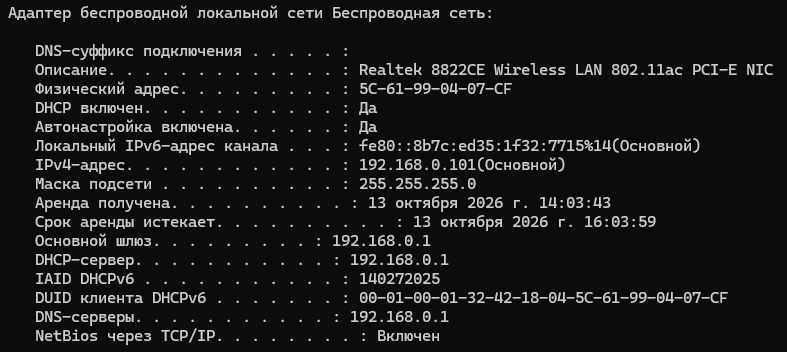
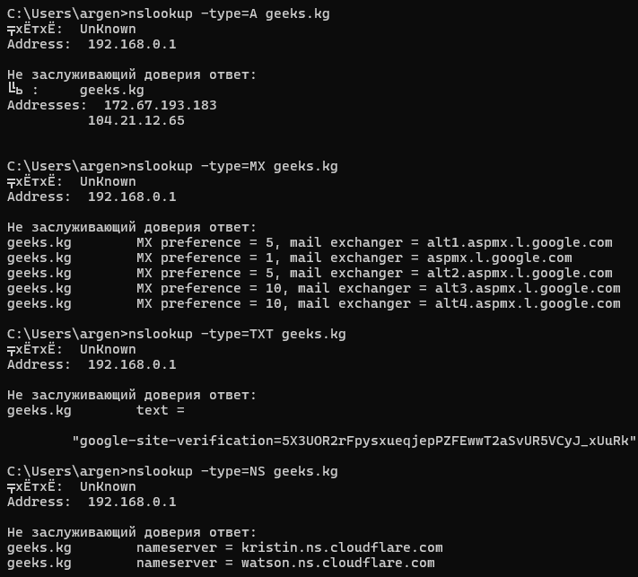

### Домашнее задание №4
___
1. Моя сеть \
Скрин ipconfig /all или аналога. Подпишите: кто DHCP-сервер, шлюз, DNS, срок аренды. \
Чей у вас DNS: роутера, провайдера или публичный (8.8.8.8, 1.1.1.1)? 
2. Разведка по DNS \
Любой крупный сайт или своя компания. Найдите записи A, MX, TXT, NS. Одним обзацем: что из жтого узнал бы атакующий? \
Только открытые DNS-запросы, никаких сканеров. 
3. Своими словами. \
DORA - на своей аналогии, не гостиница. \
Почему поддельный DHCP-сервер опасен? \
Как распознать DNS-туннель?

___

##### Задание 1

DHCP-сервер: 192.168.0.1 \
Основной шлюз: 192.168.0.1 \
DNS-сервер: 192.168.0.1 \
Срок аренды: 2 часа

DNS-сервер у меня стоит от роутера, так как его адрес совпадает с адресом шлюза, а это значит, что запросы сначала идут на роутер, а он уже их пересылает провайдеру. 
___

##### Задание 2

A-записи: 172.67.193.183, 104.21.12.65 \
MX-записи: почтовые шлюзы Google (aspmx.l.google.com, alt1.aspMx... и др.) \
TXT-записи: токен верификации google-site-verification=5X3UOR2rFpysxueqjepPZFEwwT2asSvUR5VCyJ_xUuRk \
NS-записи: серверы Cloudflare (kristin.ns.cloudflare.com, watson.ns.cloudflare.com) 
___

##### Задание 3

DORA: В кофейне \
D - Человек заходит в кофейню и грмко кричит: "Кто здесь бариста? Кофе хочу" \
O - Бариста отвечает: "Я! Могу сделать капуч" \
R - Человек отвечает: "Кайф, я именно капуч хочу" \
A - Бариста дает капуч и говорит: "На, держи капуч" 

Поддельный DHCP-сервер опасен тем, что он перехватывает контроль над сетевыми настройками устройства и пакетами, потому что весь основной трафик идет через него.

DNS-туннель можно выявить при анамально длинном имени домена, которая может содержать в себе закодированную строку (непонятные символы)